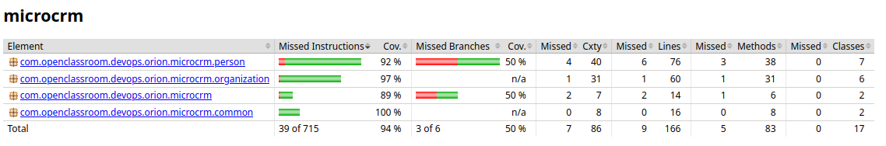

# Stratégie et exécution des tests — Backend (Spring Boot / Gradle)

Ce document décrit la stratégie de tests automatisés du backend MicroCRM (Orion), les taux de couverture actuels, ainsi que les commandes permettant de les exécuter localement et dans le pipeline CI/CD.

## 1. Vue d'ensemble

| Outils | Type de tests | Couverture actuelle |
|---|---|---|
| JUnit 5, Mockito, `@DataJpaTest`, `@WebMvcTest`, JaCoCo | Repository, Service, Controller | **94 % instructions / 50 % branches** |

Le rapport de couverture (JaCoCo, format XML) est généré à chaque exécution des tests et remonté automatiquement à SonarCloud via le pipeline CI/CD — aucune saisie manuelle de taux de couverture n'est nécessaire.

## 2. Architecture testée

Le backend suit une architecture en couches (`Controller → Service → Repository`), ce qui permet de tester chaque couche indépendamment :

| Couche | Type de test | Annotation | Ce qui est vérifié |
|---|---|---|---|
| Repository | Intégration | `@DataJpaTest` | Requêtes JPA, contraintes, relations bidirectionnelles |
| Service | Unitaire | Mockito (`@ExtendWith(MockitoExtension.class)`) | Logique métier, exceptions, cas limites |
| Controller | Intégration légère | `@WebMvcTest` | Codes HTTP, validation des DTOs, sérialisation JSON |

Classes de test actuelles :

- `PersonRepositoryIntegrationTest`, `OrganizationRepositoryIntegrationTest`
- `PersonServiceTest` (9 cas : CRUD, doublon d'email, entité introuvable)
- `OrganizationServiceTest` (11 cas, y compris gestion des membres)
- `PersonControllerTest`, `OrganizationControllerTest`
- `MicroCRMApplicationTests` (smoke test de contexte)

Un test d'intégration dédié (`whenOrganizationDeleted_thenPersonStillExists`) couvre spécifiquement la relation `@ManyToMany` bidirectionnelle et a permis de détecter le bug de `CascadeType.ALL` corrigé en `PERSIST + MERGE`.

## 3. Exécuter les tests en local

```bash
cd back
./gradlew test
```

- Résultat attendu : `BUILD SUCCESSFUL`, rapport HTML généré dans `back/build/reports/tests/test/index.html`.
- Le plugin `jacoco` est déclenché automatiquement après les tests (`finalizedBy jacocoTestReport`, configuré dans `build.gradle`) — aucune commande séparée n'est nécessaire pour générer la couverture.

## 4. Consulter la couverture

```bash
open back/build/reports/jacoco/test/html/index.html   # rapport HTML lisible
```

Le rapport XML consommé par SonarCloud est généré au même endroit :

```
back/build/reports/jacoco/test/jacocoTestReport.xml
```

Configuration `build.gradle` :

```groovy
jacoco {
    toolVersion = "0.8.11"
}

test {
    useJUnitPlatform()
    finalizedBy jacocoTestReport
}

jacocoTestReport {
    dependsOn test
    reports {
        xml.required = true
        html.required = true
    }
}
```

Le plugin `org.sonarqube` (déjà présent dans `build.gradle`) détecte automatiquement le rapport XML JaCoCo par convention — pas besoin de déclarer `sonar.coverage.jacoco.xmlReportPaths` manuellement.

## 5. Taux de couverture actuels

Résultat obtenu via `./gradlew clean test jacocoTestReport`, rapport HTML (`back/build/reports/jacoco/test/html/index.html`) :



| Package | Couverture instructions | Couverture branches | Classes |
|---|---|---|---|
| `person` | 92 % | 50 % | 7 |
| `organization` | 97 % | n/a | 6 |
| `microcrm` (racine) | 89 % | 50 % | 2 |
| `common` | 100 % | n/a | 2 |
| **Total** | **94 % (676/715 instructions)** | **50 % (3/6 branches)** | **17** |

Quality Gate SonarCloud : ✅ Passée (0 hotspot de sécurité).

**Zones non couvertes, identifiées et acceptées :**
- Le hook `@PreRemove` en conditions réelles Hibernate (difficile à isoler hors contexte transactionnel complet) — explique en grande partie l'écart sur le package `person`.
- `InitialDataFixture` (jeu de données de démarrage, sans logique métier à tester) — explique l'écart sur le package racine `microcrm`.
- Les branches non couvertes (3 sur 6 au total) correspondent à des chemins d'erreur secondaires, à examiner si l'objectif est de viser 100 % de couverture de branches.

**Dette qualité déjà résolue** : le code smell SonarQube précédemment signalé (lambda à remplacer par une référence de méthode `Person::getId` dans `OrganizationResponse`) a été corrigé.

## 6. Intégration dans le pipeline CI/CD

Le job `test-back` transmet son rapport JaCoCo en artefact au job `sonarqube-back`, les deux jobs travaillant dans des espaces isolés :

```yaml
test-back:
  stage: test
  script:
    - cd back && ./gradlew test
  artifacts:
    paths:
      - back/build/reports/jacoco/test/jacocoTestReport.xml
    expire_in: 1 hour

sonarqube-back:
  stage: quality
  needs:
    - job: test-back
      artifacts: true
  script:
    - cd back && ./gradlew sonar
```

**Règles de déclenchement :** `test-back` dispose de règles explicites (`merge_request_event` **ou** push sur branche), condition nécessaire pour que le `needs:` de `sonarqube-back` reste valide en contexte de pipeline de merge request — sans règle explicite, GitLab exclut ce job par défaut des pipelines `merge_request_event`.

**Politique de fusion :** aucune fusion vers `main` n'est possible tant que les tests ou la Quality Gate SonarQube échouent (Quality Gate bloquante).

## 7. Bonnes pratiques appliquées

- Un test de non-régression a été écrit **avant** la correction d'un bug découvert en cours de refonte (`CascadeType.ALL` → `PERSIST + MERGE`), illustrant la valeur d'une couverture de tests dès la conception plutôt qu'en fin de développement.
- Chaque couche est testée avec l'outil le plus adapté à son niveau d'isolation (`@DataJpaTest` pour la persistance, Mockito pour la logique pure, `@WebMvcTest` pour le contrat HTTP), plutôt qu'un seul type de test générique.
- Le rapport de couverture est généré automatiquement à chaque run (`finalizedBy jacocoTestReport`) : aucune étape manuelle n'est nécessaire pour maintenir les chiffres à jour.