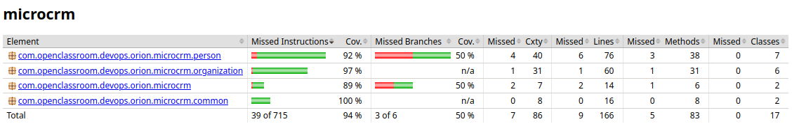

# Stratégie et exécution des tests — Backend (Spring Boot / Gradle)

## Historique et évolution

Quand j'ai pris le backend, il n'avait que deux tests : un test de démarrage du contexte Spring et un test de repository. SonarCloud affichait **0 % de couverture**, côté backend comme côté frontend. Je pensais d'abord que les tests « bloquaient » : en réalité, `./gradlew test` passait sans problème (le projet est en Gradle, pas en Maven, et j'avais lancé la mauvaise commande). Le vrai problème était double. D'une part, aucun plugin JaCoCo n'était configuré, donc aucun rapport de couverture n'était généré. D'autre part, une fois le rapport généré, il restait dans l'espace de travail du job de test et n'arrivait jamais au job Sonar, puisque chaque job de CI travaille dans un espace isolé. J'ai ajouté JaCoCo et fait passer le rapport d'un job à l'autre sous forme d'artefact.

La vraie progression est venue de la refonte en couches Controller / Service / Repository : elle m'a permis de tester chaque couche avec l'outil qui lui convient, au lieu d'un seul type de test générique. J'ai écrit les tests au fur et à mesure, et l'un d'eux a fait apparaître un vrai bug de données : la cascade `CascadeType.ALL` supprimait les personnes avec leur organisation. J'ai corrigé la cascade en `{PERSIST, MERGE}`. La couverture est passée de 0 % à 94 % des instructions.

La chaîne de tests a ensuite été migrée de GitLab CI vers GitHub Actions avec les mêmes jobs, puis réordonnée : les tests sont maintenant le premier maillon du pipeline, et la création de la version ne se fait qu'une fois qu'ils ont réussi.

## 1. Vue d'ensemble

| Outils | Types de tests | Couverture mesurée |
|---|---|---|
| JUnit 5, Mockito, `@DataJpaTest`, `@WebMvcTest`, JaCoCo | Repository, service, contrôleur | **94 % des instructions, 50 % des branches** |

La suite compte **44 tests**. Le rapport de couverture (JaCoCo, format XML) est généré à chaque exécution et envoyé à SonarCloud par la CI. Les taux ci-dessous ont été mesurés lors de la refonte du backend ; pour les vérifier aujourd'hui, relancer `./gradlew clean test jacocoTestReport`.

## 2. Architecture testée

| Couche | Type de test | Annotation | Ce qui est vérifié |
|---|---|---|---|
| Repository | Intégration | `@DataJpaTest` | Requêtes JPA, contraintes, relations bidirectionnelles |
| Service | Unitaire | Mockito (`@ExtendWith(MockitoExtension.class)`) | Logique métier, exceptions, cas limites |
| Contrôleur | Intégration légère | `@WebMvcTest` | Codes HTTP, validation des DTO, sérialisation JSON |

Classes de test :

| Classe | Tests | Contenu |
|---|---|---|
| `PersonRepositoryIntegrationTest` | 2 | Recherche par e-mail, cas négatif |
| `OrganizationRepositoryIntegrationTest` | 3 | Relation `@ManyToMany` bidirectionnelle, suppression sans effet sur les personnes |
| `PersonServiceTest` | 9 | CRUD, doublon d'e-mail, entité introuvable |
| `OrganizationServiceTest` | 11 | CRUD, gestion des membres, introuvable |
| `PersonControllerTest` | 9 | Codes HTTP, validation (e-mail invalide, prénom vide), doublon |
| `OrganizationControllerTest` | 9 | Codes HTTP, validation, association et dissociation |
| `MicroCRMApplicationTests` | 1 | Démarrage du contexte Spring |

Le test `whenOrganizationDeleted_thenPersonStillExists` couvre la relation `@ManyToMany` et a permis de détecter le bug de `CascadeType.ALL`.

## 3. Exécuter les tests en local

```bash
cd back
./gradlew test
```

Résultat attendu : `BUILD SUCCESSFUL` et `SUCCESS: Executed 44 tests`. Rapport HTML des tests : `back/build/reports/tests/test/index.html`. JaCoCo s'exécute automatiquement après les tests (`finalizedBy jacocoTestReport`), donc aucune commande séparée n'est nécessaire.

## 4. Consulter la couverture

```bash
xdg-open back/build/reports/jacoco/test/html/index.html
```

Le rapport XML que lit SonarCloud :

```
back/build/reports/jacoco/test/jacocoTestReport.xml
```

Configuration de `build.gradle` :

```groovy
jacoco {
    toolVersion = "0.8.11"
}

test {
    useJUnitPlatform()
    finalizedBy jacocoTestReport
}

jacocoTestReport {
    dependsOn test
    reports {
        xml.required = true
        html.required = true
    }
}
```

Le plugin `org.sonarqube` détecte le rapport XML par convention : il n'est pas nécessaire de déclarer `sonar.coverage.jacoco.xmlReportPaths`.

## 5. Taux de couverture

Mesuré lors de la refonte, avec `./gradlew clean test jacocoTestReport` :



| Package | Instructions | Branches | Classes |
|---|---|---|---|
| `person` | 92 % | 50 % | 7 |
| `organization` | 97 % | n/a | 6 |
| `microcrm` (racine) | 89 % | 50 % | 2 |
| `common` | 100 % | n/a | 2 |
| **Total** | **94 % (676/715)** | **50 % (3/6)** | **17** |

**Zones non couvertes, que j'ai identifiées et acceptées :**

- Le hook `@PreRemove` dans un vrai contexte Hibernate, difficile à isoler : c'est l'essentiel de l'écart du package `person`.
- `InitialDataFixture`, qui insère un jeu de données de démarrage et ne contient aucune logique métier : c'est l'écart du package racine.
- Les 3 branches non couvertes (sur 6) sont des chemins d'erreur secondaires.

SonarCloud : Quality Gate passée, avec 0 point de sécurité à examiner (*hotspot*). Un *code smell* signalé plus tôt (une lambda à remplacer par `Person::getId`) a été corrigé.

## 6. Intégration dans le pipeline

Le job `test-back` envoie son rapport JaCoCo en artefact au job `sonarqube-back`, car les deux travaillent dans des espaces séparés :

```yaml
test-back:
  runs-on: ubuntu-latest
  steps:
    - uses: actions/checkout@v4
    - uses: actions/setup-java@v4
      with:
        distribution: temurin
        java-version: 17
    - name: Tests JUnit + Jacoco
      working-directory: back
      run: ./gradlew test
    - uses: actions/upload-artifact@v4
      with:
        name: coverage-back
        path: back/build/reports/jacoco/test/jacocoTestReport.xml
        retention-days: 1

sonarqube-back:
  needs: [test-back]
  steps:
    - uses: actions/download-artifact@v4
      with:
        name: coverage-back
        path: back/build/reports/jacoco/test/
    - name: Analyse Sonar backend
      working-directory: back
      run: ./gradlew sonar
```

Ces jobs s'exécutent sur chaque Pull Request et chaque push vers `main`. La création de la version (`version`) n'a lieu qu'après leur succès : une version qui échoue aux tests n'est jamais créée.

**Politique de fusion.** Je n'ai pas activé de protection de branche sur `main`, car semantic-release doit pouvoir y pousser son commit de release. Ne fusionner une Pull Request que si les contrôles sont verts reste donc une règle que je m'impose, pas un blocage technique.

## 7. Limites

- Les tests sont rejoués deux fois de plus dans le pipeline : `./gradlew build` s'exécute dans `build-back`, puis une troisième fois pendant la construction de l'image Docker. La journalisation de `publish-images` montre bien 44 tests exécutés à cette étape. C'est une perte de temps que je pourrais supprimer en passant `-x test` à ces deux builds.
- Aucun test de bout en bout, aucun test de charge (voir [`PERF-back.md`](./PERF-back.md)).
- Le plan de test ne couvre pas les routes `PUT`, d'après la liste des tests de contrôleur ci-dessus.

## 8. Bonnes pratiques appliquées

- J'ai écrit le test qui reproduit un bug avant de le corriger (`CascadeType.ALL` → `{PERSIST, MERGE}`) : c'est ce qui m'a convaincu de tester dès la conception plutôt qu'en fin de développement.
- Chaque couche est testée avec l'outil adapté à son niveau d'isolation.
- La couverture est générée automatiquement à chaque exécution, donc les chiffres ne dépendent d'aucune étape manuelle.
