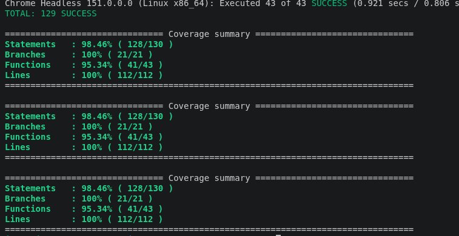

# Stratégie et exécution des tests — Frontend (Angular)

## Historique et évolution

Quand j'ai repris le frontend, ses tests passaient (8 specs en local), mais SonarCloud affichait **0 % de couverture**. En lisant `karma.conf.js`, j'ai trouvé trois causes. Le reporter `coverage` manquait dans la liste des reporters, alors que le plugin `karma-coverage` était bien chargé : aucun rapport n'était généré. Les formats configurés (`html` et `text-summary`) ne sont de toute façon pas lisibles par Sonar, qui attend du `lcov`. Et la liste des navigateurs contenait un vrai Chrome non headless, qui peut bloquer en CI sans affichage graphique (c'est aussi pour cela que mes 8 specs affichaient `24 SUCCESS` : trois navigateurs tournaient en parallèle).

J'ai donc ajouté le reporter `coverage` avec le format `lcov`, déclaré le chemin du rapport dans `sonar-project.properties` (le scanner en ligne de commande ne le devine pas, contrairement au plugin Gradle côté backend), ajouté `--code-coverage` à la commande de test, et fait passer le rapport du job de test au job Sonar sous forme d'artefact, puisque chaque job de CI travaille dans un espace isolé. La couverture réelle, enfin mesurée, était modeste : environ 33 % des instructions et 9,5 % des branches. J'en ai fait un point de départ honnête.

Plus tard, je me suis trompé sur un chiffre. Ma documentation annonçait 132 specs et 100 % de couverture, ce qui ne correspondait pas à l'état de `main`. Après la refonte du backend, j'avais bien migré les services du frontend hors du format HAL de Spring Data REST, mais ce travail était resté dans un stash Git local et n'avait jamais été poussé. Je l'ai découvert en vérifiant, je l'ai réintégré, et je ne me suis pas arrêté aux tests unitaires : j'ai démarré le frontend et le backend ensemble et rejoué à la main le scénario complet (création, association, dissociation), pour vérifier que cette couverture correspondait à un vrai comportement et pas seulement à des mocks qui passent. Les chiffres de ce document sont ceux mesurés après cette correction.

La chaîne de tests a ensuite été migrée de GitLab CI vers GitHub Actions avec les mêmes jobs. Elle est maintenant le premier maillon du pipeline : la version n'est créée qu'une fois les tests et Sonar passés.

## 1. Vue d'ensemble

| Outils | Types de tests | Couverture mesurée |
|---|---|---|
| Jasmine, Karma, karma-coverage | Composants standalone, services | **43 specs uniques, 98,46 % des instructions** |

Le rapport de couverture (format `lcov`) est généré à chaque exécution et envoyé à SonarCloud par la CI. Les taux ci-dessous ont été mesurés après la réintégration des services ; pour les vérifier aujourd'hui, relancer `ng test --code-coverage --watch=false`.

## 2. Ce qui est testé

Les tests couvrent les composants standalone, les services HTTP (`/api/persons`, `/api/organizations`) et la reconstruction côté client de la relation personne ↔ organisation. 43 specs uniques, réparties sur 6 fichiers `.spec.ts` :

- `person.service.spec.ts`
- `organization.service.spec.ts`
- `organization-details.component.spec.ts`
- `person-details.component.spec.ts`
- `main-dashboard.component.spec.ts`
- `app.component.spec.ts`

## 3. Exécuter les tests en local

```bash
cd front
ng test
```

`karma.conf.js` déclare trois lanceurs : Chrome, ChromeHeadless et ChromeHeadlessNoSandbox. En local, `ng test` les lance en parallèle, d'où `TOTAL: 129 SUCCESS` pour 43 specs uniques (43 × 3). **En CI**, je force un seul lanceur, `ChromeHeadlessNoSandbox`, qui fonctionne sans affichage graphique et sans bac à sable (nécessaire sur le runner).

Avec génération de la couverture :

```bash
ng test --code-coverage --watch=false
```

## 4. Consulter la couverture

```bash
xdg-open front/coverage/microcrm/index.html
```

Le rapport `lcov` que lit SonarCloud :

```
front/coverage/microcrm/lcov.info
```

Configuration de `karma.conf.js` :

```js
reporters: ["progress", "kjhtml", "coverage"],
coverageReporter: {
  dir: require("path").join(__dirname, "coverage/microcrm"),
  subdir: ".",
  reporters: [
    { type: "html" },
    { type: "text-summary" },
    { type: "lcov" }, // format requis par SonarCloud
  ],
},
```

Et dans `sonar-project.properties` :

```properties
sonar.projectKey=sylvainr-dev_microcrm-frontend
sonar.organization=sylvainr-dev
sonar.javascript.lcov.reportPaths=coverage/microcrm/lcov.info
```

## 5. Taux de couverture

Mesuré avec `ng test --code-coverage --watch=false` :



| Métrique | Taux |
|---|---|
| Instructions (*statements*) | 98,46 % (128/130) |
| Branches | 100 % (21/21) |
| Fonctions | 95,34 % (41/43) |
| Lignes | 100 % (112/112) |
| Specs uniques | 43 |
| Quality Gate SonarCloud | ✅ Passée |

**Ce qui reste non couvert** : 2 instructions et 2 fonctions, que je n'ai pas encore identifiées précisément (probablement des cas d'erreur mineurs). Ce n'est pas bloquant pour la Quality Gate. Le rapport HTML donne la liste exacte.

## 6. Intégration dans le pipeline

Le job `test-front` envoie son rapport `lcov` en artefact au job `sonarqube-front`, car les deux travaillent dans des espaces séparés :

```yaml
test-front:
  runs-on: ubuntu-latest
  steps:
    - uses: actions/checkout@v4
    - uses: actions/setup-node@v4
      with:
        node-version: 20
    - name: Tests Karma + couverture
      working-directory: front
      run: |
        npm ci
        CHROME_BIN=/usr/bin/google-chrome npx @angular/cli test --no-watch --no-progress --browsers=ChromeHeadlessNoSandbox --code-coverage
    - uses: actions/upload-artifact@v4
      with:
        name: coverage-front
        path: front/coverage/microcrm/lcov.info
        retention-days: 1

sonarqube-front:
  needs: [test-front]
  steps:
    - uses: actions/download-artifact@v4
      with:
        name: coverage-front
        path: front/coverage/microcrm/
    - uses: SonarSource/sonarqube-scan-action@v5
      with:
        projectBaseDir: front
```

Ces jobs s'exécutent sur chaque Pull Request et chaque push vers `main`. La création de la version n'a lieu qu'après leur succès.

**Politique de fusion.** Je n'ai pas activé de protection de branche sur `main`, car semantic-release doit pouvoir y pousser son commit de release. Ne fusionner que si les contrôles sont verts est donc une règle que je m'impose, pas un blocage technique.

## 7. Limites

- Aucun test de bout en bout automatisé : le scénario complet (création, association, dissociation) n'a été rejoué qu'à la main.
- Pas de test de la communication réelle avec le backend dans la CI : les tests des services utilisent des requêtes simulées.
- Le chemin de Chrome sur le runner (`/usr/bin/google-chrome`) est écrit en dur dans `ci.yml`.

## 8. Bonnes pratiques et leçons

- **Vérifier `git stash list` et ne jamais considérer un travail comme fini tant qu'il n'est pas poussé et validé par le pipeline.** C'est la leçon directe de mon erreur sur le nombre de specs.
- Le drapeau `--code-coverage` est toujours utilisé en CI, donc le rapport `lcov` est régénéré à chaque exécution, sans étape manuelle.
- Un lanceur headless unique en CI garantit le même comportement d'un exécution à l'autre, sans dépendre d'un affichage graphique.
- Une vérification manuelle de bout en bout complète les tests unitaires, pour s'assurer que la couverture reflète un comportement réel.
