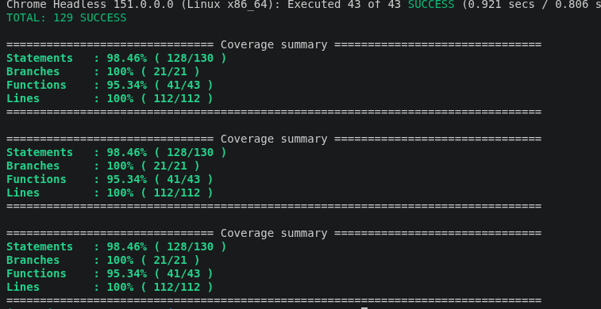

# Stratégie et exécution des tests — Frontend (Angular)

Ce document décrit la stratégie de tests automatisés du frontend MicroCRM (Orion), les taux de couverture actuels, ainsi que les commandes permettant de les exécuter localement et dans le pipeline CI/CD.

## 1. Vue d'ensemble

| Outils | Type de tests | Couverture actuelle |
|---|---|---|
| Jasmine, Karma, karma-coverage | Composants standalone, services, pipes | **43 specs uniques — 98,46 % statements** |

Le rapport de couverture (format `lcov`) est généré à chaque exécution des tests et remonté automatiquement à SonarCloud via le pipeline CI/CD — aucune saisie manuelle de taux de couverture n'est nécessaire.

> **Note de transparence** : une version antérieure de cette documentation indiquait 132 specs et 100 % de couverture. Ce chiffre ne correspondait pas à l'état réel du dépôt `main` — la migration des services (`person.service.ts`, `organization.service.ts`) hors du format Spring Data REST/HAL était restée bloquée dans un stash Git local, jamais appliquée. Une fois cette migration réintégrée (services + composants `organization-details`/`person-details` associés) et vérifiée en conditions réelles (front + back communiquant réellement), les chiffres ci-dessous sont ceux effectivement mesurés sur le dépôt à jour.

## 2. Architecture testée

Les tests couvrent les composants standalone Angular, les services HTTP (`/api/persons`, `/api/organizations`) et la logique de reconstruction de la relation personne ↔ organisation, recalculée côté client par filtrage depuis la migration hors Spring Data REST (pour éviter toute modification du backend). 43 specs uniques au total, réparties sur 6 fichiers `.spec.ts` :

- `person.service.spec.ts`
- `organization.service.spec.ts`
- `organization-details.component.spec.ts`
- `person-details.component.spec.ts`
- `main-dashboard.component.spec.ts`
- `app.component.spec.ts`

## 3. Exécuter les tests en local

```bash
cd front
ng test
```

Par défaut, `karma.conf.js` est configuré pour utiliser **ChromeHeadless** (essentiel en environnement CI/serveur sans affichage graphique — l'usage d'un Chrome non headless a été identifié comme cause de blocage des tests en CI lors d'une session de debug précédente).

Pour lancer les tests avec génération de la couverture :

```bash
ng test --code-coverage --watch=false
```

## 4. Consulter la couverture

```bash
open front/coverage/microcrm/index.html   # rapport HTML lisible
```

Le rapport `lcov` consommé par SonarCloud est généré au même endroit :

```
front/coverage/microcrm/lcov.info
```

Configuration `karma.conf.js` :

```js
reporters: ["progress", "kjhtml", "coverage"],
coverageReporter: {
  dir: require("path").join(__dirname, "coverage/microcrm"),
  subdir: ".",
  reporters: [
    { type: "html" },
    { type: "text-summary" },
    { type: "lcov" }, // format requis par SonarCloud
  ],
},
```

Et dans `sonar-project.properties` (le scanner CLI ne devine pas ce chemin automatiquement, contrairement au plugin Gradle côté back) :

```properties
sonar.javascript.lcov.reportPaths=coverage/microcrm/lcov.info
```

## 5. Taux de couverture actuels

Résultat obtenu via `ng test --code-coverage --watch=false` (exécution sur 3 navigateurs en parallèle — Chrome, ChromeHeadless, ChromeHeadlessNoSandbox —, d'où `TOTAL: 129 SUCCESS` pour 43 specs uniques) :



| Métrique | Taux |
|---|---|
| Statements | 98,46 % (128/130) |
| Branches | 100 % (21/21) |
| Functions | 95,34 % (41/43) |
| Lines | 100 % (112/112) |
| Nombre de specs uniques | 43 |
| Quality Gate SonarCloud | ✅ Passée (0 nouvelle issue) |

**Zones non couvertes, restantes à examiner** : l'écart sur *Statements* (128/130) et *Functions* (41/43) représente une poignée de lignes/fonctions non exercées — probablement des branches d'erreur ou des cas limites mineurs dans les services ou composants. Non bloquant pour la Quality Gate actuelle, mais à identifier précisément si l'on souhaite viser 100 % sur toutes les métriques (voir section 8).

## 6. Intégration dans le pipeline CI/CD

Le job `test-front` transmet son rapport `lcov` en artefact au job `sonarqube-front`, les deux jobs travaillant dans des espaces isolés :

```yaml
test-front:
  stage: test
  script:
    - cd front && ng test --code-coverage
  artifacts:
    paths:
      - front/coverage/microcrm/lcov.info
    expire_in: 1 hour

sonarqube-front:
  stage: quality
  needs:
    - job: test-front
      artifacts: true
  script:
    - cd front && sonar-scanner
```

**Règles de déclenchement :** `test-front` dispose de règles explicites (`merge_request_event` **ou** push sur branche), condition nécessaire pour que le `needs:` de `sonarqube-front` reste valide en contexte de pipeline de merge request — sans règle explicite, GitLab exclut ce job par défaut des pipelines `merge_request_event`.

**Politique de fusion :** aucune fusion vers `main` n'est possible tant que les tests ou la Quality Gate SonarCloud échouent (Quality Gate bloquante).

## 7. Bonnes pratiques appliquées

- La couverture actuelle a été atteinte en réintégrant une migration de services (`person.service.ts`, `organization.service.ts`) et de composants associés qui était restée isolée dans un stash Git local — un rappel concret de l'importance de vérifier régulièrement `git stash list` et de ne jamais considérer un travail comme terminé tant qu'il n'est pas poussé sur `main` et validé par le pipeline.
- Le flag `--code-coverage` est systématiquement utilisé en CI pour garantir que le rapport `lcov` est toujours régénéré à jour, sans étape manuelle.
- L'usage de ChromeHeadless dans `karma.conf.js` garantit un comportement identique entre l'exécution locale et l'exécution en CI, évitant les blocages liés à l'absence d'affichage graphique sur les runners.
- La validation ne s'est pas arrêtée aux tests unitaires : une vérification manuelle en conditions réelles (backend + frontend démarrés en local, scénario complet création/association/dissociation personne-organisation) a été effectuée pour confirmer que la couverture élevée correspond bien à un comportement fonctionnel réel, pas seulement à des mocks qui passent.
